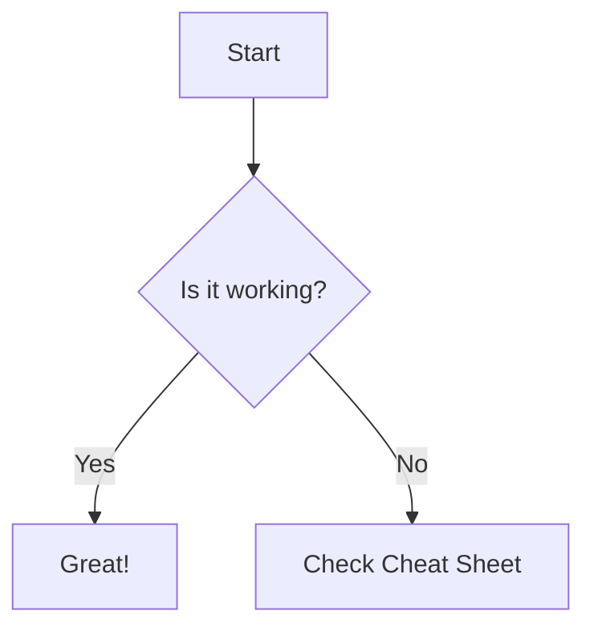

# Markdown Cheat Sheet

A comprehensive reference for Markdown features, distinguishing between standard CommonMark and GitHub Flavored Markdown (GFM).

## Table of Contents

* [Text](#text)

* [Lists](#lists)

* [Links and Images](#links-and-images)

* [Code](#code)

* [Quotes](#quotes)

* [Tables](#tables)

* [Layout](#layout)

* [GitHub Extras](#github-extras)

* [Pitfalls](#pitfalls)

## Text

### Headings

* **CommonMark**

* Headings structure your document from level 1 (`#`) to level 6 (`######`).

```
# Level 1 Heading
## Level 2 Heading
### Level 3 Heading

```

# Level 1 Heading

## Level 2 Heading

### Level 3 Heading

### Paragraphs and Line Breaks

* **CommonMark**

* Paragraphs are separated by a blank line. To force a line break within a paragraph, add two trailing spaces at the end of the line.

```
This is paragraph one.

This is line one.  
This is line two after two trailing spaces.

```

This is paragraph one.

This is line one.

This is line two after two trailing spaces.

### Italic, Bold, and Both

* **CommonMark**

* Wrap text with single asterisks or underscores for italic, double for bold, and triple for both.

```
*Italic text*, **Bold text**, and ***Bold and Italic text***.

```

*Italic text*, **Bold text**, and ***Bold and Italic text***.

### Strikethrough

* **Github** 

* Wraps text in double tildes `~~` to mark it as deleted or crossed out.

```
~~This text is struck through.~~

```

This text is struck through.

### Inline Code

* **CommonMark** 

* Encloses short code snippets or technical keywords in single backticks.

```
Use the `printf()` function in C.

```

Use the `printf()` function in C.

### Escaping Characters

* **CommonMark** 

* Precede special characters like `*`, `#`, or `\` with a backslash to print them as literal characters.

```
\*This is not italicized\* and \# is not a heading.

```

\*This is not italicized\* and # is not a heading.

## Lists

### Unordered, Ordered, and Nested Lists

*  **CommonMark**

*  Unordered lists use `-` or `*`, ordered lists use numbers, and indenting by 2-4 spaces creates nested lists.

```
1. First item
   - Nested unordered item
   - Another sub-item
2. Second item

```

1. First item

   * Nested unordered item

   * Another sub-item

2. Second item

### Task Lists

* **GitHub**

* Creates checkboxes using list items starting with `[ ]` for unchecked and `[x]` for checked items.

```
- [x] Completed task
- [ ] Pending task

```

* \[x\] Completed task

* \[ \] Pending task

## Links and Images

### Inline and Reference-style Links

* **CommonMark**

* Inline links use `[text](URL)`; reference links separate the definition from the usage via `[text][label]`.

```
[Inline Link](https://commonmark.org)

[Reference Link][1]

[1]: https://github.com

```

[Inline Link](https://commonmark.org)

[Reference Link](https://github.com)

### Relative Link to Another File

* **GitHub**

* Links directly to local files inside the same repository folder structure using relative paths.

```
[View README](../README.md)

```

[View README](../README.md)

### Link to a Section

* **GitHub**

* Links to heading anchors auto-generated on GitHub using lowercased, hyphenated section names.

```
[Jump to Code Section](#code)

```

[Jump to Code Section](#code)

### Image with Alt Text

* **CommonMark**

* Displays an image using ``.

```


```

### Image as a Link

* **CommonMark**

* Embeds an image syntax inside the square brackets of a standard link syntax.

```
[](https://commonmark.org)

```

## Code

### Fenced Code Blocks with Syntax Highlighting

* **GitHub**

* Uses triple backticks tagged with a language keyword (`python`, `bash`, `json`) for formatted code blocks.

````
```python
def greet(name):
    return f"Hello, {name}!"
```

```bash
echo "Current directory: $(pwd)"
```

```json
{
  "status": "success",
  "code": 200
}
```

````

```
def greet(name):
    return f"Hello, {name}!"

```

```
echo "Current directory: $(pwd)"

```

```
{
  "status": "success",
  "code": 200
}

```

## Quotes

### Blockquotes, Nested and with Formatting

* **CommonMark**

* Prefixes lines with `>` to create blockquotes; double `>>` creates nested quotes.

```
> "Simplicity is prerequisite for reliability."
> 
> > — Edsger W. Dijkstra (**Software pioneer**)

```

> "Simplicity is prerequisite for reliability."
>
> > — Edsger W. Dijkstra (**Software pioneer**)

### Alerts

* **GitHub**

* Renders special styled callout boxes using `> [!NOTE]`, `> [!WARNING]`, `> [!TIP]`, `> [!IMPORTANT]`, or `> [!CAUTION]`.

```
> [!NOTE]
> This is a GitHub alert callout box highlighting important details.

```

> \[!NOTE\] This is a GitHub alert callout box highlighting important details.

## Tables

### Table with Aligned Columns and Pipe Escaping

* **GitHub**

* Creates tables using pipes `|` and hyphens `-`, aligned using colons (`:---`, `:---:`, `---:`), escaping embedded pipes with `\|`.

```
| Left Aligned | Centered | Right Aligned |
| :--- | :---: | ---: |
| [Google](https://google.com) | Cell with `\|` pipe | $100.00 |

```

| Left Aligned | Centered | Right Aligned | 
| ----- | ----- | ----- | 
| [Google](https://google.com) | Cell with `|` pipe | \$100.00 | 

## Layout

### Horizontal Rules

* **CommonMark**

* Creates a horizontal line separator using three or more dashes `---`.

```
---

```

### Collapsed Sections

*  **GitHub**

* Uses HTML `<details>` and `<summary>` tags to make collapsible dropdown sections.

```
<details>
<summary>Click to expand hint</summary>

Here is the hidden solution or detail!
</details>

```

Here is the hidden solution or detail!

### Comments

* **CommonMark**

* Hides internal notes using standard HTML comment syntax `<!-- comment -->`.

```
<!-- This comment will not render in the preview -->

```

## GitHub Extras

### Footnotes

* **GitHub**

* Adds references and footnotes linked to the bottom of the document.

```
Here is a sentence with a footnote.[^1]

[^1]: This is the text explaining the footnote.

```

Here is a sentence with a footnote.\[^1\]

\[^1\]: This is the text explaining the footnote.

### Emoji Shortcodes

* **GitHub**

* Renders icons using emoji code aliases enclosed in colons.

```
:rocket: :octocat: :heavy_check_mark:

```

:rocket: :octocat: :heavy_check_mark:

### @Mentions and Issue References

* **GitHub**

* Links automatically to GitHub users using `@username` or issues/pull requests using `#number`.

```
CC: @octocat in reference to issue #42.

```

CC: @octocat in reference to issue #42.

### Mermaid Diagram

* **GitHub**

* Renders flowcharts, diagrams, and graphs directly from text descriptions.

````


````

```
graph TD;
    A[Start] --> B{Is it working?};

```

## Pitfalls

will be added once i run into them, this cheatsheet is a work in progress after all
